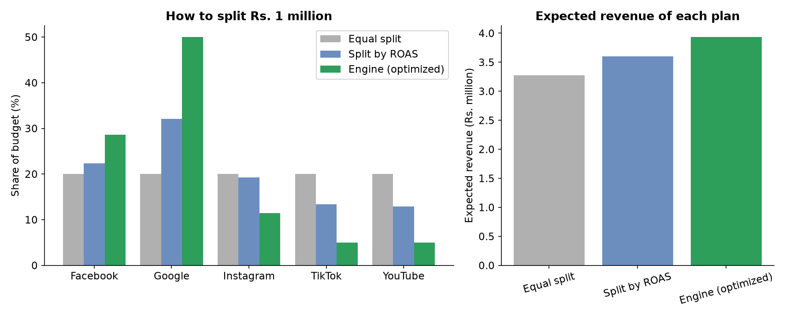
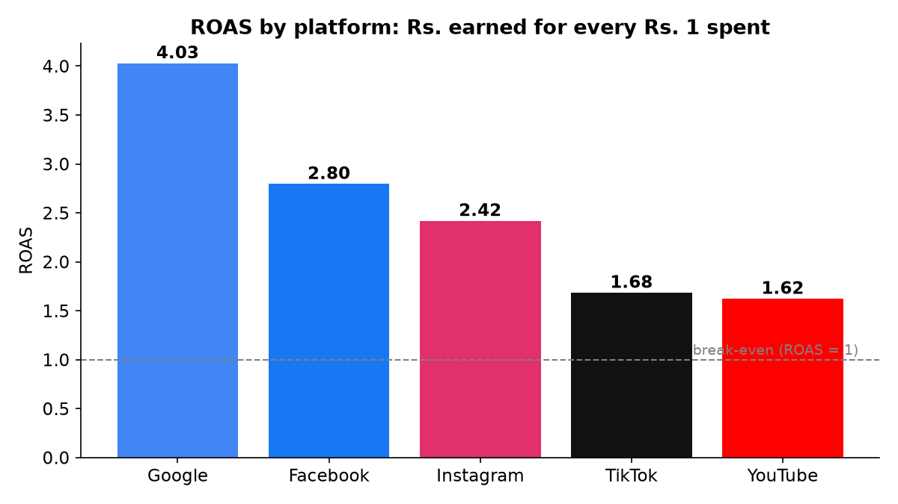
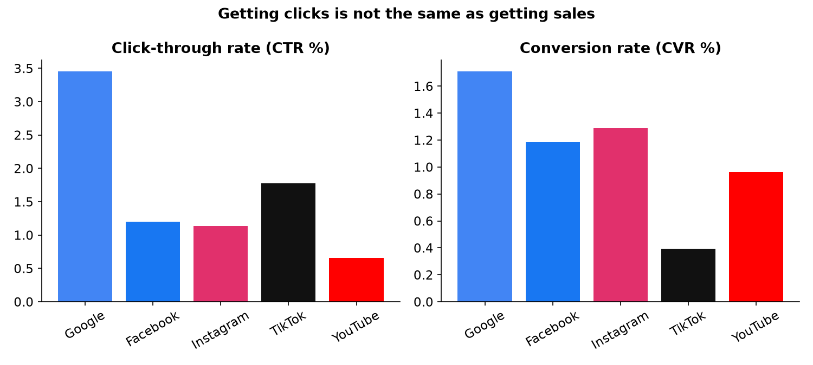
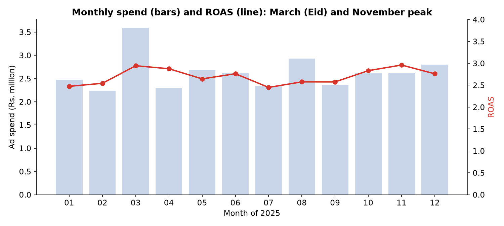
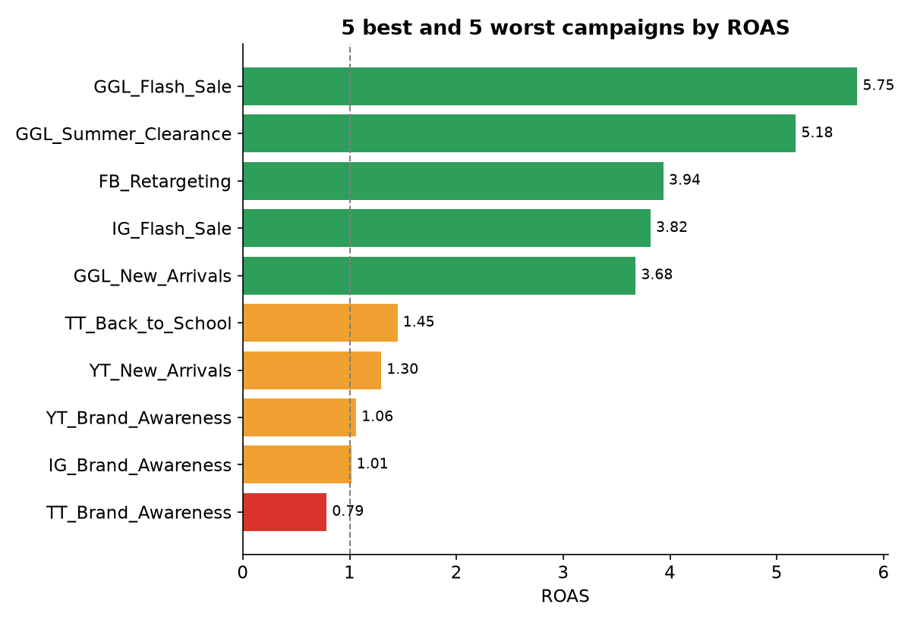
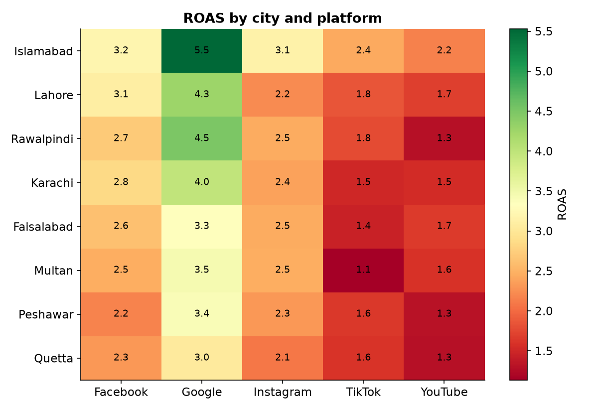
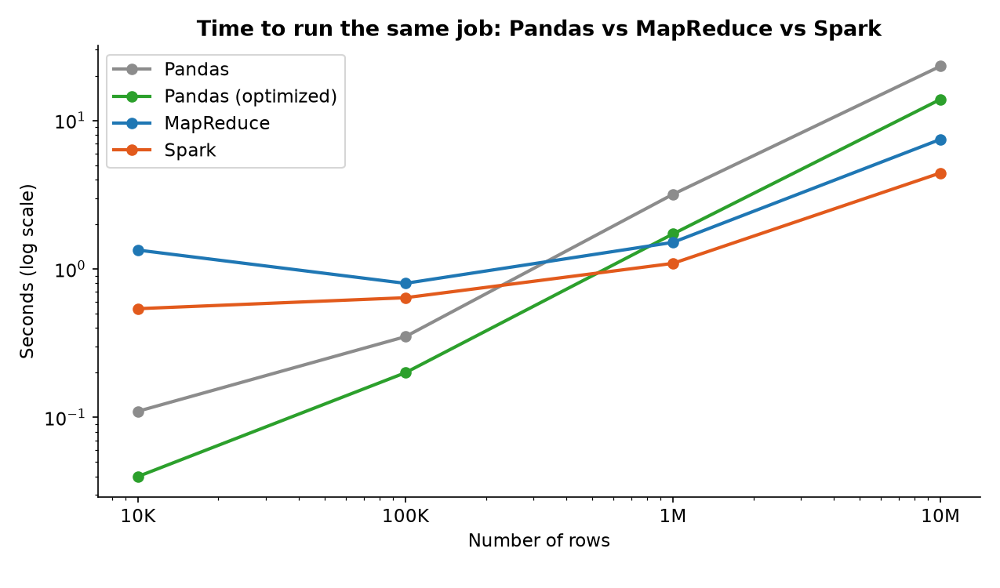
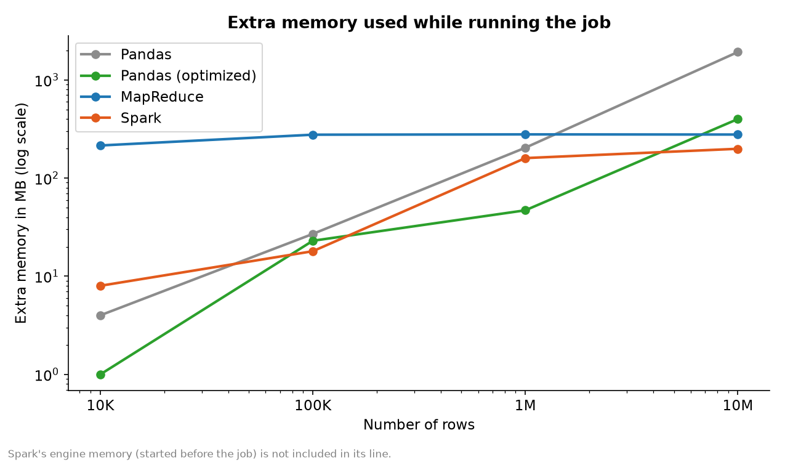
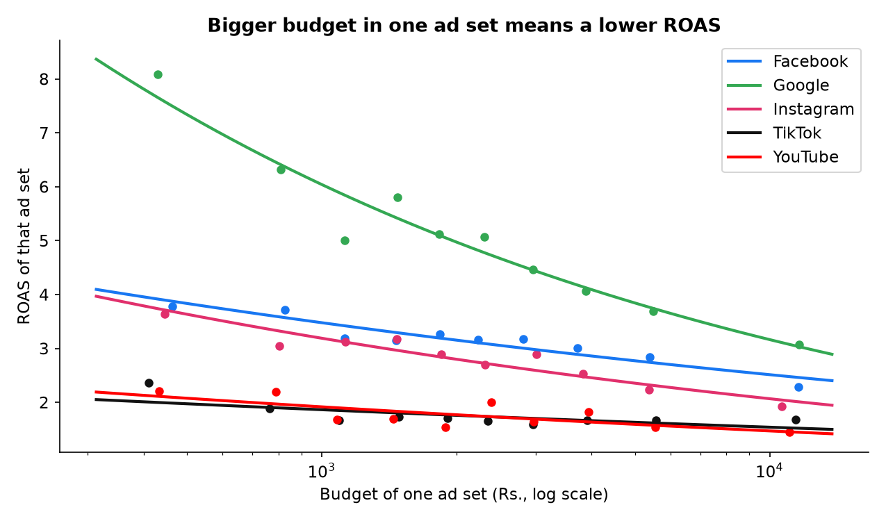

# Digital Advertising Budget Optimizer

**Big Data Analytics, Project 2** · Qazi Abdul Muiz (Kazii) · UMT, Lahore

> **Management asks: where should we spend the next Rs. 1 million?**
> This project simulates a year of advertising data for 5 platforms, measures how well each platform performs, compares **Pandas vs MapReduce vs Spark** on data from 10 thousand to 10 million rows, and builds a **Marketing Budget Recommendation Engine** that splits the budget across platforms.

**Important:** all data in this project is **simulated** (made by `src/generate_data.py`). The numbers show how the method works. They are not results from a real company.

---

## 1. The answer in one table

Recommended split of Rs. 1,000,000 for one month:

| Platform | Equal split | Split by ROAS | **Engine (this project)** |
|---|---|---|---|
| Google | 20.0% | 32.1% | **50.0%** |
| Facebook | 20.0% | 22.3% | **28.6%** |
| Instagram | 20.0% | 19.3% | **11.4%** |
| TikTok | 20.0% | 13.4% | **5.0%** |
| YouTube | 20.0% | 12.9% | **5.0%** |
| Expected revenue | Rs. 3.27 M | Rs. 3.60 M | **Rs. 3.93 M** (+20.2% vs equal split) |



---

## 2. Project structure

```
bda-project-2-ad-budget-optimizer/
├── README.md
├── requirements.txt
├── data/
│   └── sample_10k.csv          # the 10,000-record dataset (bigger files are not uploaded)
├── src/
│   ├── generate_data.py        # makes the simulated data (10K up to 10M rows)
│   ├── metrics.py              # CTR, CPC, CPA, conversion rate, ROAS, campaign rating
│   ├── charts.py               # charts 01-05
│   ├── bench_utils.py          # stopwatch + memory meter
│   ├── bench_pandas.py         # benchmark job with Pandas (plain and optimized)
│   ├── bench_mapreduce.py      # same job, MapReduce method (split, map, shuffle, reduce)
│   ├── bench_spark.py          # same job with Spark
│   ├── spark_check.py          # tiny test that Spark is installed correctly
│   ├── compare.py              # checks all tools agree + comparison charts 06-07
│   ├── response_curves.py      # diminishing returns per platform (chart 08)
│   └── engine.py               # the recommendation engine (chart 09)
├── results/                    # all result tables as CSV
└── charts/                     # all charts as PNG
```

## 3. How to run it

```bash
pip install -r requirements.txt

py src/generate_data.py --rows 10000 --out data/sample_10k.csv    # the dataset
py src/metrics.py --data data/sample_10k.csv                      # metrics
py src/charts.py --data data/sample_10k.csv                       # charts 01-05

# bigger files for the benchmark (not uploaded to GitHub, they are 9 MB to 870 MB)
py src/generate_data.py --rows 100000   --out data/ads_100k.csv
py src/generate_data.py --rows 1000000  --out data/ads_1m.csv
py src/generate_data.py --rows 10000000 --out data/ads_10m.csv

py src/bench_pandas.py
py src/bench_mapreduce.py
py src/bench_spark.py        # needs Java 17 or 21 installed
py src/compare.py

py src/response_curves.py
py src/engine.py --budget 1000000
```

Use `python` instead of `py` on Mac or Linux. The data is generated with a fixed random seed (42), so results are reproducible. Tiny differences (for example in one platform's revenue total) can appear between numpy versions.

---

## 4. The data

### Data dictionary

Each row is one **ad set**: one campaign, on one day, for one audience segment.

| Column | Type | Meaning |
|---|---|---|
| `date` | date | day in 2025 |
| `campaign` | text | campaign name, for example `GGL_Retargeting` (the prefix shows the platform) |
| `platform` | text | Facebook, Instagram, Google, TikTok or YouTube |
| `impressions` | integer | how many times the ad was shown |
| `clicks` | integer | how many people clicked |
| `spend` | float | ad cost in Rs. |
| `conversions` | integer | how many clicks ended in a purchase |
| `revenue` | float | sales in Rs. from those purchases |
| `age` | text | 18-24, 25-34, 35-44, 45-54, 55+ |
| `gender` | text | Male or Female |
| `city` | text | Karachi, Lahore, Islamabad, Rawalpindi, Faisalabad, Multan, Peshawar, Quetta |
| `device` | text | Mobile, Desktop or Tablet |

The 10,000-row file has 12 columns and no missing values.

### How the data is simulated

Money flows through a funnel: **spend → impressions → clicks → conversions → revenue.** Every platform has its own "personality":

| Platform | Cost per 1,000 views (Rs.) | Click rate | Buy rate (of clickers) | Average order (Rs.) |
|---|---|---|---|---|
| Google | 900 | 3.0% | 1.8% | 5,500 |
| Instagram | 320 | 1.0% | 1.4% | 5,200 |
| Facebook | 250 | 1.1% | 1.2% | 4,500 |
| YouTube | 200 | 0.6% | 1.0% | 5,000 |
| TikTok | 150 | 1.6% | 0.4% | 3,800 |

On top of this the simulator adds:

- **Audience effects:** age groups buy differently, Islamabad has higher order values than Quetta, Desktop converts better than Mobile.
- **Seasons** (dates are approximate): Ramadan, Eid ul Fitr, Eid ul Adha, Independence Day sale, 11.11, Black Friday and 12.12 raise both spending and buying.
- **Campaign quality:** each platform runs 6 campaigns, and each campaign has a hidden quality level.
- **Diminishing returns:** a big budget in one ad set earns less per rupee than a small one. This is what the engine later has to discover from the data.

---

## 5. Metrics

| Metric | Formula |
|---|---|
| CTR | clicks ÷ impressions × 100 |
| CPC | spend ÷ clicks |
| CPA | spend ÷ conversions |
| Conversion rate | conversions ÷ clicks × 100 |
| ROAS | revenue ÷ spend |
| Campaign performance | ROAS rating: Excellent (3 or more), Good (2 to 3), Weak (1 to 2), Losing money (below 1) |

Ratios are always calculated from **totals** (total clicks ÷ total impressions), never by averaging row-level ratios, because averaging would give a row with 100 views the same weight as a row with 100,000.

### Results by platform (10,000 records, Rs. 31.6 M total spend, Rs. 85.6 M revenue, overall ROAS 2.71)

| Platform | Spend (Rs.) | Revenue (Rs.) | CTR % | CPC | CPA | Conv. rate % | ROAS |
|---|---|---|---|---|---|---|---|
| Google | 8,326,378 | 33,548,185 | 3.46 | 25.57 | 1,495 | 1.71 | **4.03** |
| Facebook | 7,311,659 | 20,442,467 | 1.20 | 20.74 | 1,750 | 1.18 | 2.80 |
| Instagram | 6,793,257 | 16,430,279 | 1.14 | 27.76 | 2,153 | 1.29 | 2.42 |
| TikTok | 5,229,303 | 8,806,166 | 1.78 | 8.34 | 2,130 | 0.39 | 1.68 |
| YouTube | 3,903,647 | 6,334,231 | 0.66 | 30.03 | 3,113 | 0.96 | 1.62 |

**What it shows:** TikTok gets cheap clicks (CPC Rs. 8) but only 0.39% of clickers buy, so its ROAS is low. Getting clicks is not the same as getting sales.







Full tables: `results/platform_metrics.csv` and `results/campaign_performance.csv`.

---

## 6. Big data experiment: Pandas vs MapReduce vs Spark

### The job (identical for every tool)

Read the CSV file, add up impressions, clicks, spend, conversions and revenue **for each platform**, then calculate ROAS. The same job was run on 10 thousand, 100 thousand, 1 million and 10 million rows.

### The tools

- **Pandas:** plain `read_csv`, which reads all 12 columns.
- **Pandas (optimized):** reads only the 6 needed columns with smaller data types.
- **MapReduce:** the MapReduce method written in Python, running on all CPU cores. The file is split into pieces, every worker maps its piece (a small combiner adds up rows inside the worker), the results are shuffled by platform, and a reducer adds them up. This is **not** Hadoop. Real Hadoop needs Java and a cluster setup, so the MapReduce programming model was implemented directly.
- **Spark:** PySpark 4 in local mode (all CPU cores of one laptop act as the workers).

### Results (one Windows laptop, one run per cell)

**Time in seconds**

| Tool | 10K | 100K | 1M | 10M |
|---|---|---|---|---|
| Pandas | 0.11 | 0.35 | 3.18 | 23.19 |
| Pandas (optimized) | **0.04** | **0.20** | 1.72 | 13.87 |
| MapReduce | 1.34 | 0.80 | 1.51 | 7.46 |
| Spark | 0.54 | 0.64 | **1.09** | **4.43** |

**Extra memory in MB**

| Tool | 10K | 100K | 1M | 10M |
|---|---|---|---|---|
| Pandas | 4 | 27 | 204 | 1,927 |
| Pandas (optimized) | 0 | 23 | 47 | 400 |
| MapReduce | 215 | 277 | 279 | 278 |
| Spark | 8 | 18 | 160 | 199 |




### Correctness

All tools were checked against each other: for every size, the total revenue found by Pandas, MapReduce and Spark is the same (`compare.py` prints `ALL TOOLS AGREE`).

### What we learn

1. **Small data (up to 100K rows): Pandas is fastest.** MapReduce and Spark spend time starting workers, which is not worth it for small files.
2. **From about 1 million rows, Spark and MapReduce win**, because they use all CPU cores while Pandas reads the file on one core. At 10M rows Spark was about 5 times faster than plain Pandas.
3. **Memory:** Pandas needs more memory as the data grows (1.9 GB at 10M). MapReduce and Spark stay almost flat because they process the file in pieces.
4. **Pandas can be improved a lot:** reading only the needed columns made it about 1.7 times faster and used almost 5 times less memory at 10M rows.
5. **Spark's costs are not in its timing:** starting the Spark engine took about 31 seconds and used about 450 MB before any data was read. In a real cluster the engine is already running, so the benchmark times only the job. At 10M rows the optimized Pandas still used less total memory than Spark. Spark's real strength is that it can handle data far bigger than one computer's memory.

---

## 7. Marketing Budget Recommendation Engine

### Step A: learn how each platform reacts to more money

For each platform, ad sets are grouped from small to big budgets, and the curve `revenue = a × spend^β` is fitted. β = 1 means doubling the budget doubles the revenue. Lower β means stronger diminishing returns.

| Platform | Estimated β | Planted β in the simulator | Fit quality (R²) |
|---|---|---|---|
| Google | 0.719 | 0.70 | 0.992 |
| Instagram | 0.812 | 0.80 | 0.994 |
| Facebook | 0.859 | 0.85 | 0.996 |
| YouTube | 0.885 | 0.88 | 0.986 |
| TikTok | 0.917 | 0.92 | 0.992 |

The "planted β" column is only possible because the data is simulated: it shows that the method finds the hidden rule. On real data, this column would not exist.



### Step B: check that the curves can predict unseen months

The curves were learned from January to August only, then used to predict September to December:

| Platform | Predicted revenue (Rs.) | Actual revenue (Rs.) | Error |
|---|---|---|---|
| Facebook | 6,443,660 | 7,008,064 | -8.1% |
| Google | 10,847,125 | 11,415,080 | -5.0% |
| Instagram | 5,574,103 | 5,775,046 | -3.5% |
| TikTok | 2,713,751 | 2,699,286 | +0.5% |
| YouTube | 2,329,455 | 2,066,374 | +12.7% |

Errors are small, but not zero: September to December contain Black Friday and other sales, and YouTube has the fewest rows, so its estimate is the least stable.

### Step C: search for the best split

The engine tries all possible splits of the budget (optimizer: SLSQP from SciPy) and keeps the one with the highest expected revenue. Two business rules are used: **every platform gets at least 5%** (no platform is abandoned) and **no platform gets more than 50%** (no dependence on one platform).

### Why this split is best

| Platform | Budget (Rs.) | Share | Extra revenue from the next Rs. 1 | Budget per ad set (Rs.) |
|---|---|---|---|---|
| Google | 500,000 | 50.0% | 3.44 | 2,304 |
| Facebook | 285,512 | 28.6% | 2.83 | 1,475 |
| Instagram | 114,488 | 11.4% | 2.83 | 625 |
| TikTok | 50,000 | 5.0% | 1.86 | 366 |
| YouTube | 50,000 | 5.0% | 1.84 | 486 |

- Facebook and Instagram earn the **same** Rs. 2.83 from the next rupee, which is the sign of a balanced split.
- Google is held at the 50% limit. Its next rupee still earns more (Rs. 3.44), so without the limit the engine would give it even more.
- TikTok and YouTube sit at the 5% minimum because their next rupee earns the least.

### Comparison with simple plans

| Plan | Expected revenue (Rs.) | Expected ROAS |
|---|---|---|
| Equal split (20% each) | 3,271,605 | 3.27 |
| Split by ROAS | 3,597,037 | 3.60 |
| **Engine** | **3,933,178** | **3.93** |

The engine gives **+20.2%** revenue compared with an equal split.

---

## 8. Limitations

1. **The data is simulated.** The conclusions describe how the method behaves, not how real Pakistani advertisers perform.
2. **The engine is compared with other plans using its own model.** It wins under the model by design. The September to December test shows the model is reasonable (errors from 0.5% to 12.7%), but it is not a test of the plan itself.
3. **Assumptions of the engine:** the Rs. 1 million is for one month, each platform keeps about the same number of ad sets as in the past, and platforms do not influence each other (for example, YouTube views raising Google searches are not modelled).
4. **The 5% and 50% limits are business rules we chose.** Other limits give another split.
5. **Benchmark:** one run per cell on a single laptop. Timings will differ on other computers, and the larger files were made by the same generator, not collected from real campaigns. The MapReduce tool is a Python implementation, not Hadoop, and Spark ran in local mode, not on a cluster.
6. **A scalable tool matters when data grows:** the 10M-row file is 870 MB. At 1 billion rows it would be about 87 GB, which does not fit in a laptop's memory, and Spark running on a cluster would then be the right tool.

## 9. Requirements

Python 3.10 or newer (tested on 3.14), the libraries in `requirements.txt`, and Java 17 or 21 only for the Spark benchmark.